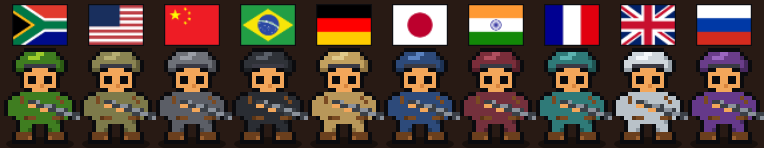
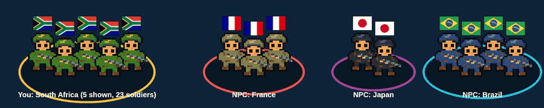

# Geopolitics

**A single-player, Risk-style strategy game.** You pick a country, nine random rivals join, and everyone fights
for the world with dice. The rivals are computer players that explain every decision they make, an AI writes the
battle commentary, and the whole thing plays out on a 3D globe with pixel-art soldiers, flags and tumbling dice.

> Built for the **UCT INF4001 Honours entrance exam (2027)**. ASP.NET Core MVC, MongoDB, Three.js, Claude.

<p align="center"></p>

---

## Markers: start here (2 minutes)

| | |
|---|---|
| **Live site** | https://geopolitics-game-9oxl.onrender.com (free hosting: if the site has been idle, the first load can take up to a minute) |
| **Login** | user `marker` / password `Marker2027Demo` (or sign up with your own account; anyone can) |
| **Run it locally instead** | open `Geopolitics.sln` and press Run, or `dotnet run --project src/Geopolitics.Web`. The zip already holds the database settings. |
| **Bonus feature** | 3D graphics and animation (see [Finding your way around](#finding-your-way-around)) |

**A quick check, in order:**

1. Open the live site and **log in**. Click **New game** and choose a country.
2. On the game page you should see the **3D globe**, a label with a soldier count on every country, and a **roster** of all ten countries under the globe.
3. On your turn, **attack** (click two countries, press **Start attack**, then **Roll dice**). Watch the dice, the falling soldiers and the **Log** tab, where every computer move has a blue **Why:** line.
4. Press **Fast-forward** while the computer players play: every move and reason is still shown.
5. Open **My games** to try the **search** and the **status filter**, and the **Countries** tab to try its search and owner filter.
6. Copy the game's address into a private window: you can **watch** it live, but you cannot play.

**Where to find the evidence:** the brief, requirement by requirement, is in [Does it meet the exam brief?](#9-does-it-meet-the-exam-brief), with a marksheet map under it. The design explanations are in [Database design](#6-database-design-mongodb), [Security](#7-security) and [The computer players and the AI](#8-the-computer-players-and-the-ai).

**One honest note about the AI commentary:** the live site currently shows the built-in fallback commentary, because the Anthropic account used for this project has no API credit. The Claude integration is written and tested, and switches on as soon as a funded key is set (see section 8). Everything else on the site is live.

---

## 1. The 60-second summary

- **What it is:** a turn-based conquest game. Ten countries, one winner. You win by owning all ten.
- **How a battle works:** both sides roll one die per soldier; the higher die wins and the other soldier is lost.
- **Who you play against:** nine computer players. Each one shows a short "Why:" line for every move, so you can
  see what it is thinking, and an AI (Claude) narrates the battles.
- **How it looks:** a 3D globe. Soldiers in a different uniform per player stand on their countries, each with the
  flag of the player's home country above the head, so you can tell opponents apart at a glance.
- **Who can do what:** anyone with a game's link can *watch* it live. Only the logged-in owner can *play* it.
  Anyone can sign up and start their own game.
- **Where the data lives:** an online MongoDB database. The server decides every outcome; the browser only shows it.

## 2. Run it in 3 steps (any IDE, or the command line)

You need the **.NET 10 SDK** ([download](https://dotnet.microsoft.com/download)) and an internet connection.

1. **Unzip** the project.
2. **Run** it, either way:
   - open `Geopolitics.sln` in Visual Studio, JetBrains Rider or VS Code and press **Run** (start project:
     `Geopolitics.Web`), **or**
   - in a terminal, in the project folder: `dotnet run --project src/Geopolitics.Web`
3. **The browser opens by itself** at `http://localhost:5033/`. Click **Sign up**, make an account, then
   **Start a new game**.

The hand-in zip already contains the database settings (`appsettings.Submission.json`), so there is nothing to
configure. If the browser does not open, go to `http://localhost:5033/` yourself (see
[Troubleshooting](#14-troubleshooting)).

## 3. How to play

Each turn you can do these things:

| Action | What it does |
|---|---|
| **Place reinforcements** | From round 2 you get **2 soldiers per country you own** at the start of your turn. Put them on any of your countries. |
| **Move soldiers** | Shift soldiers between your own countries (never while an attack is under way). A country always keeps at least 1. |
| **Attack** | Pick one of your countries (needs at least 2 soldiers) and a target. You may attack **once per turn**. |
| **End turn** | Pass to the next player. |

**You can also click countries on the globe** to fill in the attack drop-downs. A **Back to My games** link at the
top of the game page takes you back to your list of games.

### A battle, step by step

Soldiers per country come from population (1 for under 5 million people, up to 9 for over 150 million).

1. The number of dice rolled by *each* side is the smaller of: (attacker's soldiers − 1) and the defender's soldiers.
   *Example: attacker 10, defender 2 → 2 dice each. Attacker 3, defender 5 → 2 dice each. Attacker 2, defender 5 → 1 die each.*
2. Dice are paired (first with first, second with second). The **higher die wins**; the other side loses a soldier.
   A tie changes nothing.
3. Keep rolling until you **conquer** the country (it has no soldiers left), are **left with 1 soldier** (the attack
   ends and the country is safe), or **stop** (which ends your turn).
4. When you conquer a country you gain **max(2, half the defender's starting soldiers)** soldiers there.
   *Example: conquering a country with 9 soldiers gives you max(2, 4) = 4.*
5. A player who loses all their countries is **eliminated**. Own all ten countries and you **win**.

**Fast-forward** speeds up the computer players. Every move and every "Why:" line is still shown.

### Finding your way around

The app has a handful of pages. A bar at the top of every page lets you move between them.

**The top bar**

| You are... | You see | What it is for |
|---|---|---|
| Signed out | **Log in**, **Sign up** (top right) | Make an account or sign in. You can still *watch* any game from its link. |
| Signed in | **New game**, **My games** (top left), your username and **Log out** (top right) | Start a game, go back to your list, or sign out. |
| Anywhere | **Geopolitics** (top left) | Takes you to the home page. |

**The pages**

| Page | How to get there | What you do there |
|---|---|---|
| **Home** | Click **Geopolitics** | A short welcome, the line-up of ten soldiers with their flags, and buttons to start or open games. |
| **Sign up / Log in** | Top right | Create an account (username 3 to 20 letters, numbers or underscores; password of 8 or more characters with a letter and a number), or sign in. |
| **New game** | Top bar | Pick your home country from the world list. Nine random rivals are added and the game opens. |
| **My games** | Top bar | Your list of games with the date started (UTC), status (in progress, won or lost) and round. Type in the search box to find a game by date or status, or use the status drop-down. The counter ("Showing 1 of 3 games") tells you what the filter is doing. Click **Open** to go into a game. |
| **The game page** | **Open** on *My games*, or a link someone shared | Where you play or watch. Described below. |
| **Page check** | Type `/diagnose.html` after the site address | A health check for when the globe is blank. See [Troubleshooting](#14-troubleshooting). |

**The game page, area by area**

| Area | Where | What it shows or does |
|---|---|---|
| **Top strip** | Very top | **Back to My games** (when signed in), the game's status line (whose turn it is, or the result), a **Fast-forward** button (only while the computer players are taking their turns) and a badge saying whether you are playing or spectating. |
| **The globe** | Big area on the left | The ten countries. Drag the globe to turn it. Each country has a label with its name and its **true** soldier count, and a squad of up to five pixel soldiers wearing their owner's uniform with the owner's home flag above their heads. Click a label to choose that country for an attack. |
| **Battle card** | On the globe, during a fight | The dice for the attacker and the defender, and who won each pair. |
| **Roster** | Strip under the globe | Every country and its soldiers, always visible, even when the globe is turned away from it. |
| **Narration** | Under the roster | What is happening right now, the computer player's reason (**Why:**) and the AI commentary. |
| **Controls** | Top of the side panel (owner only, on your turn) | **Place reinforcements**, **Move soldiers**, **Attack** (Start attack, Roll dice, Stop) and **End turn**. Visitors never see these. |
| **Log tab** | Side panel | A chat-style history of every event, newest at the bottom. |
| **Players tab** | Side panel | Who is playing and who has been eliminated. |
| **Countries tab** | Side panel | A table of every country and its owner and soldiers, with a **search box** (country or owner) and an **owner filter**. |

**What the colours and signs mean**

| What you see | Meaning |
|---|---|
| Blue italic **Why:** line in the log | The computer player's reason for its move. |
| Green italic line in the log | The AI commentary for that battle. |
| A die that turns **green** / **red** / stays white | It won / lost / tied its pair. |
| Green camouflage soldiers | You. Each rival has its own uniform. |
| A coloured ring under a country | Its owner's colour (you are always gold). |
| A number on a label | The true soldier count, even when fewer soldiers are drawn. |

**Your first turn, step by step**

1. **Sign up** (or log in) and click **New game**. Choose your home country.
2. On the game page, wait for your turn. If the computer players go first, press **Fast-forward** to speed them up. Every move and every **Why:** line is still shown.
3. When the status line says it is your turn, **place reinforcements** (from round 2: 2 soldiers for each country you own). Choose a country, a number and press **Place**.
4. **Attack:** choose where to attack from and where to attack (or click the two countries on the globe), then press **Start attack** and **Roll dice**. Keep rolling, or press **Stop**. You may attack once per turn.
5. Optionally **move soldiers** between your own countries (a country always keeps at least 1).
6. Press **End turn**. Watch the rivals play, read their **Why:** lines in the **Log** tab, and use the **Countries** tab to search or filter.
7. Go **Back to My games** whenever you like. The game is saved, so you can open it again later and carry on.

**Watching someone else's game**

Copy the address of a game page from the browser and open it in another window (or send it to a friend). Without logging in you see the same globe, roster and log, with a **Spectating** badge and no controls. The page checks for news every 2 seconds, so moves appear live. Only the logged-in owner can play.

## 4. What makes it special

| Feature | Picture |
|---|---|
| **Pixel-art soldiers**, one uniform per player (you are green camouflage). Up to five stand on each country, and the label shows the true number. They stand, shoot during battles, fall when a die is lost, run to conquer, and drop in as reinforcements. |  |
| **Watercolour dice** that tumble onto the countries and land on the number the server rolled. Green = won, red = lost. |  |
| **AI commentary** for each battle, with built-in text as a fallback if the AI is slow or unavailable. | |
| **A reason for every computer move**, even in fast-forward. | |
| **Live viewing:** share the game link and anyone can watch; the page replays new moves as they happen. | |
| **Everything drawn in code:** the soldiers, dice, brick walls and globe need no image files to host (see `tools/`). | |

## 5. How it works inside

```
 Browser (Three.js globe, chat box)                       Server (ASP.NET Core)
 ┌──────────────────────────────┐   JSON    ┌───────────────────────────────────────────────┐
 │ page.js   buttons, log, tabs │ ───────►  │ Web        controllers, login, JSON API         │
 │ playback.js  replays events  │           │ Services   turns, NPC brain, AI commentary      │
 │ globe.js  3D drawing only    │ ◄───────  │ Engine     dice and battle rules (pure code)    │
 └──────────────────────────────┘  events   │ Data       MongoDB documents and repositories   │
                                            └───────────────────────┬─────────────────────────┘
                                                                    ▼
                                                           MongoDB Atlas (online)
```

**The golden rule: the server decides, the browser displays.**

1. You click *Roll dice*. The browser sends one JSON request (a small package of text data).
2. The server checks it is legal and that you own the game, rolls the dice, and saves the new state and a list of
   *events* ("Germany rolled [6, 2] against France [3, 5]...").
3. The reply carries the new state and the events. The browser puts the events in a **queue** (a waiting line) and
   plays them one at a time on the globe (dice tumble, a soldier falls), then resets its picture to the server's state.
4. Watchers poll every 2 seconds (the page asks the server "anything new?") and replay the same events, so a shared
   link is a live view.

Why this design?
- **Cheating is impossible from the browser:** it never decides anything. Even the phase "an attack is in progress"
  is saved in the database, so closing the tab or refreshing cannot undo it.
- **The rules are easy to test:** the Engine has no database and no web code. Dice come in through an interface, so
  tests use fixed dice and check exact results.
- **Computer players cannot cheat:** they use the very same move functions as you, so an illegal NPC move is refused.

### The four projects

The code is split into four layers. Each layer only talks to the one below it, so a change in one place does not
break the others.

| Project | Job | Key files |
|---|---|---|
| `Geopolitics.Engine` | Pure game rules | `BattleEngine`, `SoldierTable`, `IDice` |
| `Geopolitics.Data` | MongoDB: documents, repositories behind interfaces | `MongoContext`, `GameDoc`, `UserDoc`, `GameEvent` |
| `Geopolitics.Services` | Game flow, NPC brain, AI commentary | `GameActions`, `TurnManager`, `NpcStrategy`, `Odds`, `ClaudeCommentator` |
| `Geopolitics.Web` | Controllers, API, views, browser scripts | `GameController`, `GamesApiController`, `AccountController`, `wwwroot/js/game/` |

## 6. Database design (MongoDB)

MongoDB suits this project because a game is one self-contained object that is always read and written as a whole,
while the log of what happened only ever grows. MongoDB stores *documents* (think of one document as one filled-in
form, saved as a unit) grouped into *collections* (think of a collection as a drawer of similar forms).

| Collection | One document is... | Important fields |
|---|---|---|
| `users` | an account | username (unique), password hash and salt, created date |
| `games` | a whole game | owner, status (`InProgress`/`Won`/`Lost`), round, phase (`Action`/`Attacking`), current player, pending reinforcements, the active attack, **`players[]`** (name, human or NPC, home country, turn order, eliminated) and **`countries[]`** (code, name, population, owner, soldiers), and a `Version` number |
| `events` | one thing that happened | game id, **sequence number**, round, type, player, dice rolls and losses, message, the NPC's justification, the AI commentary, and the countries and counts involved |

Design decisions, in plain words:
- **Players and countries are embedded in the game document.** "Embedded" means they are stored *inside* the game
  rather than in their own collections. They are small (ten countries), always used together with the game, and a
  single save keeps them consistent.
- **Events are a separate collection** because the list only grows. Each event gets a **sequence number** (1, 2, 3...),
  so a client asks "give me events after number 41" and never downloads the history again. This also gives the
  replay and live viewing for free.
- **Indexes** are like the index of a book: they let the database find things quickly without reading everything.
  They are created at start-up: unique username (no two accounts share a name); games by owner and date (for
  *My games*); events by game and sequence (unique).
- **`Version`** is a counter on the game that goes up on every save. If you double-click, or have two tabs open, the
  second request carries an out-of-date number and is rejected, so a move can never be applied twice. (The technical
  name is *optimistic concurrency*.)
- Access is only through repository interfaces (`IUserRepository`, `IGameRepository`, `IEventRepository`). A
  repository is the one class that talks to the database for one kind of data, so the rest of the code never touches
  the database driver and the database could be swapped without changing the game rules.

## 7. Security

| Protection | Where | What it stops, in plain words |
|---|---|---|
| Passwords stored as salted hashes (ASP.NET Core's password hasher), never in plain text | `AccountService` | Even someone who reads the database cannot see anyone's password. A *hash* scrambles it one way; a *salt* makes identical passwords look different. |
| Sign-up rules checked on the server: username 3 to 20 letters, numbers or underscores; password 8 to 100 characters with a letter and a number | `AccountRules`, view-model attributes | Weak or strange input is refused, even if someone bypasses the web page. |
| Cookie login: HttpOnly, SameSite, Secure outside development, 7-day sliding expiry | `Program.cs` | *HttpOnly*: scripts on the page cannot read the login cookie. *SameSite*: the cookie is not sent when another website triggers a request. *Secure*: it only travels over HTTPS. *Sliding expiry*: you stay signed in for 7 days from your last visit. |
| Anti-forgery tokens on every form (sign-up, log in, log out, new game) | `AccountController`, `GameController` | A hidden one-time code proves the form came from this site, so another site cannot submit a form in your name. |
| Login and sign-up attempts limited per IP address | rate limiter in `Program.cs` | Stops a program from trying thousands of passwords (10 attempts per minute per address). |
| Reading a game is public, but **every move needs a login** and the service checks the caller owns the game | `GamesApiController`, `GameService` | Anyone can watch, but nobody can play someone else's game: no login gives 401, the wrong owner gives 403. |
| The move API accepts JSON only, so another website cannot post to it | `[Consumes("application/json")]` | Ordinary forms from other sites cannot send JSON, which closes another door to forged requests. |
| Visitors never see private data: the page receives a trimmed copy of the game, not the database record | `GameSnapshot` | The owner's account details never leave the server. |

## 8. The computer players and the AI

**The NPC brain** (`NpcStrategy`) is the same for every computer player. (NPC means non-player character: a computer
player.) It works from the *exact* probability of winning a fight (`Odds`, which works through every possible dice
result), not from guesses:

1. **Reinforcements:** try each of its countries as a launch point, and put all the new soldiers where they set up the
   best attack. If no attack looks good enough, strengthen its weakest country.
2. **Attack:** only if the chance to conquer is at least **55%**. It scores each possible attack as
   *chance × value − (1 − chance) × cost*, where value counts the soldiers gained, the extra reinforcements a new
   country brings, and a bonus for knocking out a rival. It takes the best-scoring attack.
3. **Keep rolling or stop:** it carries on while the chance stays at or above **40%**, then ends its turn.
4. **Transfers:** after attacking it moves a spare soldier into any country left with just 1.

Every decision carries a one-line reason built from the same numbers (for example "7 vs 1 soldiers gives about 98%
to conquer"), and the log shows it as **Why:**.

**The AI commentary** (`ClaudeCommentator`, `CommentaryService`): after a move, the events are grouped into battles and
sent to Claude, which writes one dramatic sentence per battle. It has a time limit; if Claude is slow, missing a key,
or offline, built-in template text is used instead, so the game never waits or breaks.

> **Note for markers:** the deployed site currently runs on the built-in fallback commentary, because the Anthropic account used for this project has no API credit. The Claude integration is complete and tested (with a fake web server). It switches on as soon as a funded key is set in `Anthropic__ApiKey` (or in `appsettings.Submission.json` for a local run).

## 9. Does it meet the exam brief?

| Requirement in the brief | Where it is done |
|---|---|
| Single player against NPCs; win by conquering the world | `GameFactory`, `TurnManager` |
| 10 countries: yours (chosen from the world list) plus 9 random | *New game* page, `GameFactory` |
| Soldiers by population table | `SoldierTable` |
| Random first player; NPC turns simulated | `GameFactory`, `NpcTurnRunner` |
| One attack per turn; at least 2 soldiers to attack; transfers keeping 1 soldier | `GameActions` |
| Dice rules, pairing, ties, conquest reward, elimination | `BattleEngine`, `GameActions` |
| Reinforcements: 2 per country from round 2, placed anywhere | `TurnManager`, *Place reinforcements* |
| Fast-forward that still shows the moves | `playback.js`, *Fast-forward* button |
| All countries and soldier counts visible at all times | labels on the globe, and the always-visible **roster** under the globe |
| Battles shown visually, with AI commentary | 3D dice and soldiers, `ClaudeCommentator` |
| NPCs play to win and justify every decision, also in fast-forward | `NpcStrategy`, the **Why:** lines |
| Anyone can watch via the link; only the logged-in owner plays; anyone can sign up | public `GET`, `[Authorize]` moves, owner check |
| NoSQL database, online | MongoDB Atlas |
| Web application on a server | ASP.NET Core; see [Deployment](#12-deployment) |

### Marking guide: where to look for each criterion

| Marksheet criterion | Evidence |
|---|---|
| Database layer (separate, configured, appropriate, online) | `src/Geopolitics.Data`, interfaces, MongoDB Atlas, section 6 |
| Connection to the database | `MongoContext`: connects and creates indexes when the app starts (see the start-up log) |
| Design of the database | Section 6 |
| Coding structure (framework, best practice) | ASP.NET Core **MVC** (Model-View-Controller: data, pages and the code between them kept apart), four layers, dependency injection (classes are handed what they need instead of building it themselves), section 5 |
| Object-oriented concepts (classes, encapsulation) | repositories behind interfaces, `GameDoc`/`CountryState`/`PlayerState` classes, `GameSnapshot` records, services such as `GameService` and `AccountService`, `IDice` |
| Data validation, controls, security | Section 7 |
| Functionality; lists, searching, filtering, viewing | *My games*: list with **search** (date or status) and **status filter**; game view and public viewing; *Countries* tab with **search** (country or owner) and **owner filter**; *Players* tab; an always-visible roster of all ten countries |
| User interface; ease of navigation | brick-wall site, 3D globe, chat-style side panel with tabs, navigation bar, and a **Back to My games** link on the game page (shown to signed-in users) |
| Authentication and authorisation | Section 7 |
| Sophistication and complexity | battle engine, NPC odds and scoring, AI commentary with fallback, concurrency control, replay queue, 3D rendering |
| AI application | `ClaudeCommentator` (section 8) |

## 10. Bonus feature

**3D graphics and animation** (idea 4 in the brief): the Three.js globe, pixel-art soldiers with flags, watercolour
dice, battle animations and the brick-wall interface. (Sharing a link to watch a game live is also in, as part of the
access-control requirement.)

## 11. Tests

```
dotnet test                              # C# tests: rules, NPC, commentary, snapshots, the browser opener
node --test tests/web-js/*.test.js       # tests for the browser scripts (needs Node 18 or newer)
```

There are over a hundred of each. The C# tests cover the battle engine with fixed dice, the NPC strategy, the move
rules, the AI commentary (with a fake web server) and the game snapshot. The browser tests run the real globe code
(dice, soldiers, flags, playback) without a browser.

## 12. Deployment

 A `Dockerfile` is included. It is a recipe that packages the app into a *container* (a sealed box
that runs the same everywhere), so any host that runs containers works (Render, Azure App Service, Fly.io, Railway, ...).

Steps (the names of the buttons differ a little between hosts):

1. Put the project on GitHub and connect that repository to the host. Choose to create a **web service** that builds
   from the **Dockerfile** in the project folder (some hosts call this "Docker" as the runtime).
2. Add these **environment variables** (settings the host passes to the app, so no secrets are stored in the code):
   - `Mongo__ConnectionString`: the connection string from MongoDB Atlas
   - `Mongo__DatabaseName`: for example `geopolitics`
   - `Anthropic__ApiKey`: optional; without it the built-in commentary is used
   - `ASPNETCORE_FORWARDEDHEADERS_ENABLED=true`: the host handles HTTPS
   - `ASPNETCORE_URLS=http://+:8080`: the port the app listens on (the Dockerfile already sets this)
3. In MongoDB Atlas, open **Network Access** and allow the host's IP addresses, otherwise the app cannot reach the
   database. (Allowing `0.0.0.0/0` works for a short-lived exam project but lets any address attempt a connection, so
   keep the database password strong.)
4. Deploy, open the web address the host gives you, then sign up, play one full turn and check the commentary.
5. Put that address and a demo login in section 13.

## 13. Settings, submission details and the hand-in zip

| Setting | Meaning | Set with |
|---|---|---|
| `Mongo:ConnectionString` | MongoDB connection string (**required**) | `appsettings.Submission.json`, user-secrets, or env var `Mongo__ConnectionString` |
| `Mongo:DatabaseName` | database name (default `geopolitics`) | same |
| `Anthropic:ApiKey` | key for the AI commentary (optional; built-in text without it) | same, or `Anthropic__ApiKey` |
| `Startup:OpenBrowser` | open the browser at start-up (on in Development, off otherwise) | `Startup__OpenBrowser=true` or `false` |

To set up your own copy, copy `src/Geopolitics.Web/appsettings.Submission.example.json` to `appsettings.Submission.json`
and fill it in (that file is git-ignored, so your passwords never reach GitHub). If the database setting is missing,
the app says so and stops.

**Making the zip to hand in:**

```
git add -A && git commit -m "Final"
node tools/make-submission.js            # add --with-ai-key to include the Anthropic key (use a key with a spend limit)
```

This writes `submission/Geopolitics-INF4001.zip`: every committed file plus the database settings, without `bin`, `obj`
or `.git`.

**Submission details:**

- **Deployed site:** `https://geopolitics-game-9oxl.onrender.com`
- **Application login for the markers:** user `marker` / password `Marker2027Demo`
- **Database access:** the three marker accounts (ammarcanani@gmail.com, mc.tanner@uct.ac.za,
  ridewaan.hanslo@uct.ac.za) were added to the MongoDB Atlas project; the connection string is in
  `appsettings.Submission.json`.

## 14. Troubleshooting

| Problem | What to do |
|---|---|
| The browser did not open | Go to `http://localhost:5033/`. Opening is automatic in Development; check the first lines of the console for the address. Set `Startup__OpenBrowser=true` to force it. |
| "No database settings found" | `appsettings.Submission.json` is missing. Copy the example file and fill it in (section 13). |
| The page says *Loading...* or the globe is blank | Open **`http://localhost:5033/diagnose.html`** (no login needed). It tests the browser (WebGL), every game file and module, runs a demo globe, and inspects your real game page. The first red line names the problem. |
| The port is already in use | Run `dotnet run --project src/Geopolitics.Web --urls http://localhost:5050` |
| Can't connect to the database | Check the internet connection and that your IP address is allowed in MongoDB Atlas (Network Access). |
| Commentary looks plain | No Anthropic key is set, so the built-in text is used. The game works the same. |
| A warning about an "https port for redirect" in the console | Harmless when running locally over plain http. It only means the redirect to https is skipped. |

## 15. Folder map

```
Geopolitics.sln          open this in any IDE
src/                     the four projects (Engine, Data, Services, Web)
tests/                   C# tests (xUnit) and tests/web-js (Node tests for the browser scripts)
tools/                   scripts that generate the artwork and the hand-in zip
docs/images/             pictures used by this README
Dockerfile               for deployment
```

## 16. Credits

Three.js (MIT), flag-icons (MIT), world-atlas map data (ISC), Permanent Marker font (Apache 2.0). Anthropic's Claude writes
the commentary. The soldier and dice artwork, brick walls and globe are drawn in code (see `tools/`).

## 17. In plain words

| Word | What it means here |
|---|---|
| **NPC** | A computer-controlled player. |
| **Server / browser** | The server is the program that holds the rules and the data; the browser is your window onto it. |
| **API** | The menu of requests the browser can send to the server (for example "roll the dice"). |
| **JSON** | A simple text format for sending data between browser and server. |
| **MongoDB / NoSQL** | A database that stores whole documents instead of rows in tables. |
| **Atlas** | MongoDB's online hosting, so the database is reachable from anywhere. |
| **Repository** | The one class that reads and writes one kind of data in the database. |
| **Interface** | A promise of what a class can do, without saying how. It lets tests swap in a fake (such as fixed dice). |
| **Dependency injection** | Classes are given the things they need instead of creating them, which makes them easy to test and swap. |
| **MVC** | Model-View-Controller: data, pages and the code that connects them are kept in separate places. |
| **Hash and salt** | A one-way scramble of a password, plus a random extra so the same password never looks the same twice. |
| **Cookie** | A small note the browser keeps so the site knows you are still logged in. |
| **Rate limit** | A cap on how many tries one address gets per minute. |
| **Container / Docker** | A sealed package of the app that runs the same on any host. |
| **Environment variable** | A setting given to the app from outside, used to keep secrets out of the code. |

## Author

Mpho Matheba
